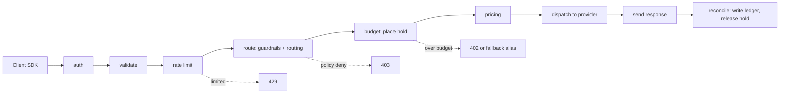

# Spillway

> An AI spend gateway that enforces budgets inside the request path, so a call that would breach a limit is refused before the provider is contacted.

Spillway is an OpenAI- and Anthropic-compatible gateway. You point your SDK at it, and every completion, message and embedding request is authenticated, priced, checked against policy, held against a budget, dispatched, and reconciled. Most AI cost tools read the provider bill and draw a chart. Spillway sits in front of the provider, so the same budget cascade that produces the report also decides whether the request happens.

**Status: parked (2026-10-23).** Spillway is a finished, self-hostable project that is no longer under active development. There is no hosted service, no signup, no pricing and no SLA. You run it yourself, from this repo, against your own Postgres.

Built by [Aadi Sharma](https://github.com/AAdityaisme). Licensed under Apache 2.0.

## What it does

- **Hard budgets.** Budgets cascade org > team > virtual key > provider, over day, month or rolling-30-day periods. In `enforce` mode an over-budget call gets a `402`, or is served under a fallback alias.
- **Reservations, not guesses.** The budget stage places a conservative hold on the counters before dispatch. Concurrent requests see each other's in-flight holds, so they cannot all slip under a cap. The hold is released at reconcile.
- **A billing ledger.** Each upstream attempt is written to `request_attempts`, keyed by `(request_id, attempt_number)` and inserted idempotently in the same transaction as the counter bump. Money is integer micro-USD (`bigint`) in code and `numeric(14,6)` in Postgres.
- **Governance as code.** Guardrail policies are CEL conditions, validated and cost-bounded when you author them. The gateway compiles them when its policy cache fills and reuses them on every request until the cache refreshes. Routing rules support aliases, priorities and fallback chains. Automation rules react to alerts and approval events. Approval workflows support multi-tier chains, delegation, expiry and HMAC-signed approve/deny links.
- **Chargeback.** Statements by virtual key, team or model, with CSV export. Totals are cross-checked against the attempts ledger and the enforcement counter, so drift shows up as a warning.
- **Two wire formats.** OpenAI `POST /v1/chat/completions` and `POST /v1/embeddings`, plus Anthropic `POST /v1/messages` (and `GET /v1/models`). Requests translate across OpenAI, Anthropic, Gemini and OpenAI-compatible providers.
- **Streaming that still gets metered.** SSE responses are teed as they stream, and usage is reconciled when the stream ends.
- **Rate limits.** RPM, TPM and max-parallel per virtual key, with `429` and `retry-after`.

## Architecture

A request to `/v1/chat/completions`, `/v1/messages` or `/v1/embeddings` runs these stages in order (see `apps/server/src/data-plane/pipeline/`). `GET /v1/models` runs only authentication. Guardrails and routing both run inside the route stage.



The success path sends the response first and writes spend after, so the client never waits on the ledger write. Reconcile catches and logs its own errors instead of throwing.

One Node process serves everything:

| Path     | Plane         | Auth                                                 |
| -------- | ------------- | ---------------------------------------------------- |
| `/v1/*`  | Data plane    | Virtual key (`Authorization: Bearer` or `x-api-key`) |
| `/api/*` | Control plane | WorkOS session plus `X-Spillway-Org`                 |
| `/app`   | Dashboard     | WorkOS AuthKit                                       |

The data plane never imports from the control plane. The one cross-plane reuse is deliberate: the control plane validates CEL conditions at write time with the same evaluator the data plane enforces with, so a policy that saves is a policy that runs.

## Engineering notes

- **Tenancy in the database.** Org-scoped tables use Postgres row-level security with `FORCE`, and the app sets the org through a transaction-local setting (`withOrg` in `apps/server/src/db/tenancy.ts`). `pnpm migration-lint` fails a migration that adds an org table without a policy. Cross-tenant isolation has its own integration tests.
- **Custom semgrep rules** in `.semgrep/` enforce repo invariants: no `parseFloat` or float coercion on money, no raw SQL outside `db/`, no `process.env` outside `config.ts`, and tenancy headers read only where they are owned.
- **Security gates** in `.github/workflows/`: CodeQL, semgrep, gitleaks and TruffleHog, OSV-scanner, a blocking `pnpm audit --prod`, a frozen-lockfile install, zizmor-linted workflows, and an SBOM step in release gates.
- **Red-team rounds.** Adversarial review findings were fixed with regression tests, for example `apps/server/src/control-plane/redteam-fixes.integration.test.ts`. The semgrep rule scope was widened after one such round.
- **Tests.** Unit tests, integration tests against real Postgres through testcontainers, a migration lint, and a scheduled stress harness (`tools/stress`) that targets budget races and scheduler lease contention.
- **Append-only where it matters.** `audit_log` and `approval_decisions` have `UPDATE` and `DELETE` revoked from the app role.

## Run it yourself

You need Node 22 or newer, pnpm 10 and Docker. You do not need a WorkOS account or provider keys to build, test or boot the server.

```bash
pnpm install
cp .env.example .env     # fill in values; never commit .env
pnpm db:up               # Postgres 18 in Docker
pnpm db:migrate
pnpm db:seed             # mints a dev org and a virtual key (printed once)
pnpm dev                 # server on :3000
pnpm dev:web             # dashboard on :5173, in a second terminal
```

To send real traffic you add a provider key. `db:seed` registers an OpenAI key when `OPENAI_API_KEY` is set. Then point an SDK at `http://localhost:3000/v1` with the seeded virtual key.

The dashboard login uses WorkOS AuthKit, so it needs WorkOS credentials. The `/v1` API does not.

Checks that mirror CI:

```bash
pnpm typecheck && pnpm lint
pnpm test                # unit, no database
pnpm test:integration    # needs Docker
pnpm migration-lint
pnpm gate                # all of the above plus web tests and build
```

## For reviewers: where to look

| If you care about  | Read                                                                                                    |
| ------------------ | ------------------------------------------------------------------------------------------------------- |
| Request lifecycle  | `apps/server/src/data-plane/README.md` (stage order and the landmines)                                  |
| Budget holds       | `apps/server/src/data-plane/budget/reservation.ts`, `budget/resolver.ts`                                |
| Reconcile + ledger | `apps/server/src/data-plane/reconcile.ts`, `request_attempts` in `apps/server/src/db/schema.ts`         |
| Money math         | `packages/pricing/src/`, `.semgrep/money-decimal-safety.yaml`                                           |
| CEL guardrails     | `apps/server/src/data-plane/policy/bounds.ts`, `condition-evaluator.ts`, `guardrails.ts`                |
| Routing, fallbacks | `apps/server/src/data-plane/routing/`, `data-plane/health/store.ts`                                     |
| Provider adapters  | `apps/server/src/data-plane/providers/` (`translate.ts` does cross-format conversion)                   |
| Streaming          | `apps/server/src/data-plane/streaming/sse-tee.ts`                                                       |
| Approvals          | `apps/server/src/services/approvals/`, `services/automation/`                                           |
| Tenancy            | `apps/server/src/db/tenancy.ts`, `db/rls-lint.test.ts`, `control-plane/tenancy-rls.integration.test.ts` |
| Supply chain       | `.github/workflows/security.yml`, `ci.yml`, `release-gates.yml`                                         |

## Docs

[Quickstart](https://spillway.mintlify.site/quickstart) and [API reference](https://spillway.mintlify.site/api-reference/introduction) live at [spillway.mintlify.site](https://spillway.mintlify.site). Some examples there use a hosted URL that no longer exists. Use `http://localhost:3000` instead.

## Stack

- **Server:** TypeScript, Fastify 5, Drizzle with postgres-js, zod, pino, `@bufbuild/cel`.
- **Web:** Vite, React 18, Tailwind 4, TanStack Router and Query.
- **Packages:** `@spillway/shared` (zod contracts, error taxonomy), `@spillway/pricing` (cost math), `@spillway/certifier` (provider conformance probes).
- **Infra:** Postgres, Docker, WorkOS AuthKit, GitHub Actions. Deploy workflows target Fly.io and Neon.

## Layout

```
apps/server      gateway and control-plane API (data-plane, control-plane, services, db, jobs)
apps/web         dashboard SPA
apps/landing     static landing page
apps/docs        markdown docs and the generated OpenAPI spec (pnpm build:openapi)
docs-mintlify    the published docs site source
packages/        shared, pricing, certifier
tools/           seed, dev token, OpenAPI build, backup, stress
ops/k6           SLO load scripts
.semgrep/        custom static-analysis rules
```

## Contributing and security

This project is parked, so expect slow or no review. See [CONTRIBUTING.md](CONTRIBUTING.md) before opening anything. Report security issues privately, as described in [SECURITY.md](SECURITY.md).

## License

[Apache License 2.0](LICENSE).
